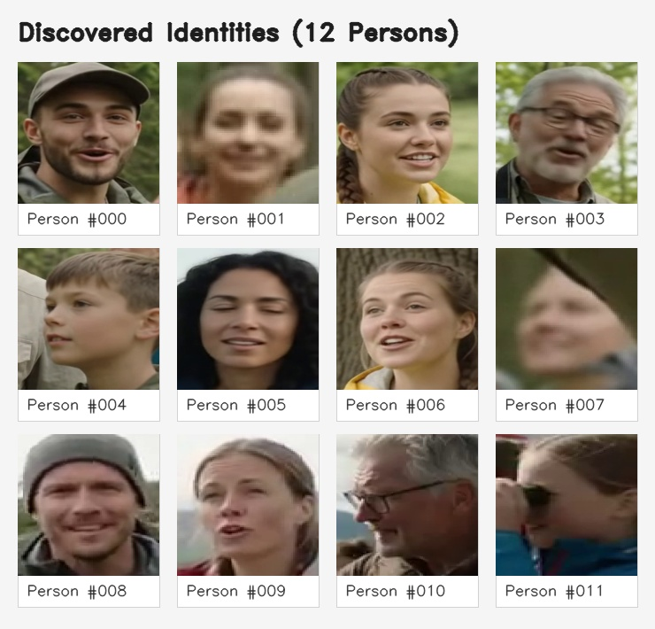

# Video Face Recognition & Cross-Video Clustering Pipeline

An intelligent, lightweight, and robust Python system that extracts human faces across one or multiple videos, recognizes unique identities using deep neural network embeddings, automatically clusters them into organized folders by person ID and source video, provides one-click jump-to-timestamp links for every face, and visualizes connections between videos and people through conceptual mind maps (tankediagram).

## NB! This web solution has a MIT license
This WEB solution uses follwing third-party AI models:
- YUNET_URL = "https://github.com/opencv/opencv_zoo/raw/main/models/face_detection_yunet/face_detection_yunet_2023mar.onnx" (has MIT license)
- SFACE_URL = "https://github.com/opencv/opencv_zoo/raw/main/models/face_recognition_sface/face_recognition_sface_2021dec.onnx" (has apache commons 2.0 license)

DO NOT ALTER, IN ANY WAY, THIS MIT LICENSE (FOR THIS WEB SOLUTION) - IT MAY GIVE LEGAL ISSUES WITH PEOPLE BEHIND MODELS, GIVEN IN URL ABOVE!


---

## 🤖 Viktig merknad om AI-generert innhold / AI Disclosure

> [!IMPORTANT]
> **Alle bilder og videoer i dette prosjektet er syntetiske og AI-generert med Google Gemini.**
> 
> * **Bilder:** Portrettbildene i `data/` (`person_a.jpg`, `person_b.jpg`, `person_c.jpg`).
> * **Videoer:** `gemini_generated_video_d6f2b3bb.mp4`, `sample_test_video.mp4`, `sample_videos/*.mp4`, og flervideodatasettet i [`videos/`](https://github.com/roblar658/faceImagesExtractAndClusterFromVideo/tree/main/videos) ([`gemini_generated_video_2205156f.mp4`](https://github.com/roblar658/faceImagesExtractAndClusterFromVideo/blob/main/videos/gemini_generated_video_2205156f.mp4), [`gemini_generated_video_662b64d0.mp4`](https://github.com/roblar658/faceImagesExtractAndClusterFromVideo/blob/main/videos/gemini_generated_video_662b64d0.mp4), [`gemini_generated_video_ab8243d5.mp4`](https://github.com/roblar658/faceImagesExtractAndClusterFromVideo/blob/main/videos/gemini_generated_video_ab8243d5.mp4)).
> 
> Ingen av ansiktene eller videoklippene forestiller ekte personer; alt demonstrasjonsmateriale er generert ved hjelp av Gemini.

---

## 🌟 Hovedfunksjoner / Key Features

1. **Kryss-video analyse (Cross-Video Clustering)**:
   - Skann flere videoer samtidig (`--videos vid1.mp4 vid2.mp4` eller `--video-dir mapper/`).
   - Gjenkjenner samme person på tvers av ulike videofiler og knytter identiteter sammen.
   - Fremhever automatisk **kryss-video personer** som opptrer i to eller flere videoer.

2. **Klar og ryddig mappestruktur**:
   - Resultatmappen organiseres etter identitet, og deretter etter kildevideo:
     `person_000/gemini_generated_video_2205156f/` og `person_000/gemini_generated_video_662b64d0/`.
   - Du ser umiddelbart i filutforskeren hvilke videoer hver person forekommer i.

3. **Direkte referanse og tidshopp for hvert bilde**:
   - For hvert eneste ansiktsbilde lagres en tilhørende HTML-hurtighoppfil (`face_..._jump.html`).
   - Dobbeltklikk på HTML-filen i Windows Utforsker eller macOS Finder for å åpne videoen direkte i nettleseren spolt nøyaktig til sekundet og bildet der ansiktet ble observert!
   - Full CSV-eksport (`timestamps.csv`) med eksakt sekund, formatering (`00:01.400`), framenummer og direkte hopplenke.

4. **Visualisering som Tankediagram (Mind Map)**:
   - **Statisk høyoppløselig diagram (`mindmap_diagram.png`)**: Viser kildevideoer (fargekodede kort) og personer (sirkulære foto-avatarer) koblet sammen med vektede buer og tidsintervaller. Kryss-video personer utheves med gullring.
   - **Interaktivt web-dashbord (`index.html`)**: Dynamisk lerret med fysikksimulering (dra, zoom, klikk noder), integrert videospiller med tidslinje, ansiktsgalleri og kryss-video matrise.

5. **Enkle oppstartsskript for Windows og Linux/macOS**:
   - `run_clusterer.ps1`: Interaktiv meny, automatisk oppdagelse av virtuelt miljø, og åpner automatisk dashbordet i nettleseren.
   - `run_clusterer.sh`: Bash-ekvivalent for Linux og macOS.

---

## Eksempel


## 📊 Resultater & Eksempel: Kryss-video analyse av 3 videoer (`cross_video_output/`)

Dette eksempelet er kjørt direkte opp mot testdatasettet som ligger i GitHub-mappen [**`videos/`**](https://github.com/roblar658/faceImagesExtractAndClusterFromVideo/tree/main/videos).

Kjørt med:
```powershell
# Med Python direkte:
python main.py --video-dir videos --output cross_video_output --frame-interval 5

# Eller enkelt med PowerShell-hjelpeskriptet:
.\run_clusterer.ps1 -VideoDir "videos" -Output "cross_video_output"

# Eller på Linux / macOS:
./run_clusterer.sh --dir "videos" --output "cross_video_output"
```

### 1. Visuelt Tankediagram (Mind Map)
Diagrammet illustrerer koblingene mellom de tre videoene og personene. Gullringer indikerer **kryss-video personer** som opptrer i flere videoer, mens kantetikettene angir antall observasjoner og tidsintervall:


---

### 2. Oppdagede Identiteter (12 Personer)
Algoritmen oppdaget og separerte automatisk 12 distinkte personidentiteter på tvers av de tre videoene:



---

### 3. Nøkkeltall fra analysen

* **Kildevideoer analysert fra [videos/](https://github.com/roblar658/faceImagesExtractAndClusterFromVideo/tree/main/videos):**
  * [`gemini_generated_video_2205156f.mp4`](https://github.com/roblar658/faceImagesExtractAndClusterFromVideo/blob/main/videos/gemini_generated_video_2205156f.mp4) (11.5 MB — 99 ansikter detektert)
  * [`gemini_generated_video_662b64d0.mp4`](https://github.com/roblar658/faceImagesExtractAndClusterFromVideo/blob/main/videos/gemini_generated_video_662b64d0.mp4) (2.5 MB — 104 ansikter detektert)
  * [`gemini_generated_video_ab8243d5.mp4`](https://github.com/roblar658/faceImagesExtractAndClusterFromVideo/blob/main/videos/gemini_generated_video_ab8243d5.mp4) (6.5 MB — 33 ansikter detektert)
* **Totalt detekterte ansikter:** 236 ansikter
* **Oppdagede unike personer:** 12 identitetsklynger (`person_000` til `person_011`)
* **Uklassifisert støy:** Kun 2 ansikter (`unclustered/` - under 1% støy)
* **⭐ Kryss-video personer (funnet på tvers av videoer):** **7 personer**
  * `person_000`: 31 ansikter — funnet i **alle 3 videoene** (13 i vid 1, 12 i vid 2, 6 i vid 3)
  * `person_001`: 6 ansikter — funnet i **2 videoer** (3 i vid 1, 3 i vid 3)
  * `person_002`: 15 ansikter — funnet i **alle 3 videoene** (5 i vid 1, 5 i vid 2, 5 i vid 3)
  * `person_003`: 41 ansikter — funnet i **alle 3 videoene** (17 i vid 1, 17 i vid 2, 7 i vid 3)
  * `person_004`: 35 ansikter — funnet i **alle 3 videoene** (17 i vid 1, 12 i vid 2, 6 i vid 3)
  * `person_005`: 41 ansikter — funnet i **alle 3 videoene** (14 i vid 1, 22 i vid 2, 5 i vid 3)
  * `person_006`: 14 ansikter — funnet i **2 videoer** (7 i vid 1, 7 i vid 2)
* **Enkeltvideo-personer:** 5 personer
  * `person_007`: 22 ansikter (kun i `gemini_generated_video_2205156f`)
  * `person_008`: 6 ansikter (kun i `gemini_generated_video_662b64d0`)
  * `person_009`: 7 ansikter (kun i `gemini_generated_video_662b64d0`)
  * `person_010`: 8 ansikter (kun i `gemini_generated_video_662b64d0`)
  * `person_011`: 8 ansikter (kun i `gemini_generated_video_662b64d0`)
* **Silhouette Score:** `0.4903`

---

### 4. Mappestruktur i `cross_video_output/`

Strukturen er inndelt etter person og deretter kildevideo, med egne hurtighoppfiler:

```text
cross_video_output/
├── mindmap_diagram.png          # Høyoppløselig grafisk tankediagram
├── index.html                   # Interaktivt webdashbord med graf og videospiller
├── timestamps.csv               # Komplett tabell over alle 236 observasjoner og tidshopp
├── identities_montage.jpg       # Samlet bildekort av alle 12 identitetene
├── metadata.json                # Full maskinlesbar metadata
├── person_000/                  # ⭐ KRYSS-VIDEO IDENTITET (i alle 3 videoer)
│   ├── gemini_generated_video_2205156f/
│   │   ├── face_0001_frame000015_t000.62s.jpg
│   │   └── face_0001_frame000015_t000.62s_jump.html  <- Dobbeltklikk for direkte hopp til 00:00.625!
│   ├── gemini_generated_video_662b64d0/
│   │   ├── face_0001_frame000015_t000.62s.jpg
│   │   └── face_0001_frame000015_t000.62s_jump.html
│   └── gemini_generated_video_ab8243d5/
│       ├── face_0001_frame000015_t000.62s.jpg
│       └── face_0001_frame000015_t000.62s_jump.html
├── person_001/                  # ⭐ KRYSS-VIDEO IDENTITET (i 2 videoer)
│   ├── gemini_generated_video_2205156f/
│   └── gemini_generated_video_ab8243d5/
├── person_002/ ... person_006/  # ⭐ Flere kryss-video personer
├── person_007/ ... person_011/  # Enkeltvideo personer
└── unclustered/                 # 2 uskarpe ansikter (støy)
```

---

## 🛠️ Installasjon / Setup

1. **Klon repoet:**
   ```bash
   git clone https://github.com/roblar658/faceImagesExtractAndClusterFromVideo.git
   cd faceImagesExtractAndClusterFromVideo
   ```

2. **Opprett virtuelt miljø og installer avhengigheter:**
   ```bash
   python -m venv .venv

   # På Windows:
   .\.venv\Scripts\activate
   pip install -r requirements.txt

   # På Linux/macOS:
   source .venv/bin/activate
   pip install -r requirements.txt
   ```

---

## 💻 Bruk / Usage

### 🚀 Enkelt med PowerShell (Windows):
Kjør skriptet direkte for en interaktiv meny eller send inn parametere:
```powershell
# Interaktiv meny (lar deg velge videoer eller kjøre demo direkte):
.\run_clusterer.ps1

# Prosesser testmappen med de 3 inkluderte videoene:
.\run_clusterer.ps1 -VideoDir "videos" -Output "cross_video_output"

# Prosesser spesifikke videoer:
.\run_clusterer.ps1 -Videos "video1.mp4", "video2.mp4" -Output "mine_resultater"

# Rask syntetisk demokjøring (2 videoer med felles person):
.\run_clusterer.ps1 -Demo
```
*Skriptet oppdager automatisk virtuelt miljø (`.venv`), kjører analysen og åpner det ferdige dashbordet (`index.html`) automatisk i standard nettleser!*

---

### 🐧 Enkelt med Unix / macOS:
Gjør skriptet kjørbart og kjør:
```bash
chmod +x run_clusterer.sh

# Interaktiv meny:
./run_clusterer.sh

# Rask syntetisk demo:
./run_clusterer.sh --demo

# Skann mappen med de 3 inkluderte videoene:
./run_clusterer.sh --dir "videos" --output "cross_video_output"
```

---

### 🐍 Direkte med Python:

```bash
# Prosesser en hel mappe med videoer (f.eks. den inkluderte videos/-mappen):
python main.py --video-dir "videos" --output "cross_video_output" --frame-interval 5

# Oppgi flere videofiler direkte:
python main.py --videos "videos/gemini_generated_video_2205156f.mp4" "videos/gemini_generated_video_662b64d0.mp4" --output "kryss_resultater"

# Enkeltvideo:
python main.py --video "gemini_generated_video_d6f2b3bb.mp4" --output "resultater" --frame-interval 5
```

---

## ⚙️ Kommandolinjevalg / CLI Arguments

| Parameter | Type | Standard | Beskrivelse |
| :--- | :--- | :--- | :--- |
| `--video` / `--videos` | strings | *valgfri* | Én eller flere stier til videofiler (støtter også wildcard som `'vids/*.mp4'`). |
| `--video-dir` | string | `None` | Mappe som inneholder videoer (skanner automatisk alle `.mp4`, `.avi`, `.mkv`, etc.). |
| `--output` | string | `face_clusters_output` | Mappe der mapper, bilder, tidshopp-filer, tankediagram og oversikt lagres. |
| `--frame-interval` | int | `5` | Prøvetar hver N-te frame (f.eks. 5 = ~5-6 frames/sek ved 25-30 fps). |
| `--method` | choice | `dbscan` | Klyngealgoritme: `dbscan` (tetthetsbasert) eller `agglomerative` (hierarkisk). |
| `--eps` | float | `0.45` | Cosinus-avstandsterskel (lavere = strengere, høyere = slår sammen mer). |
| `--min-samples` | int | `2` | Minimum antall observasjoner for å danne en gyldig personklynge i DBSCAN. |
| `--score-thresh` | float | `0.8` | Minimum deteksjonskonfidens fra YuNet (0.0 til 1.0). |
| `--min-face-size` | int | `40` | Minimum pikselstørrelse på ansiktet (filtrerer bort små bakgrunnsansikter). |
| `--crop-margin` | float | `0.25` | Ekstra marg (prosent) rundt ansiktsutsnitt for naturlig portrett (0.25 = 25%). |
| `--use-aligned` | flag | `False` | Lagre 112x112 justerte ansiktsutdrag i stedet for naturlige portretter. |
| `--max-frames` | int | `None` | Maksimalt antall frames per video (kjekt for rask testing). |
| `--models-dir` | string | `models` | Mappe for automatisk nedlasting og caching av ONNX-modellene. |

---

## 📂 Prosjektstruktur

```text
├── run_clusterer.ps1                   # Enkel PowerShell-kjører med meny og auto-åpning i nettleser
├── run_clusterer.sh                    # Enkel Bash/Unix-kjører for Linux og macOS
├── main.py                             # CLI-inngangspunkt med kryss-video og flervideo-støtte
├── clusterer.py                        # Deteksjon, 128-d SFace-vektorer og kryss-videoklynging
├── visualizer.py                       # Tankediagram-generator (PNG), interaktivt web-dashbord & tidshopp-filer
├── generate_sample_video.py            # Generator for syntetiske kryss-video datasett
├── requirements.txt                    # Nødvendige Python-pakker (OpenCV, scikit-learn, networkx, matplotlib, Pillow)
├── README.md                           # Dokumentasjon, resultatoversikt og AI disclosure
├── data/                               # AI-genererte referanseportretter (Gemini)
│   ├── person_a.jpg
│   ├── person_b.jpg
│   └── person_c.jpg
├── sample_videos/                      # Genererte syntetiske testvideoer (2 videoer med felles person)
│   ├── video_intervju_del1.mp4
│   └── video_intervju_del2.mp4
├── videos/                             # Flervideo-testsett (Gemini-generert): https://github.com/roblar658/faceImagesExtractAndClusterFromVideo/tree/main/videos
│   ├── gemini_generated_video_2205156f.mp4
│   ├── gemini_generated_video_662b64d0.mp4
│   └── gemini_generated_video_ab8243d5.mp4
└── cross_video_output/                 # Resultater fra kryss-video analyse (3 videoer)
    ├── mindmap_diagram.png             # Grafisk tankediagram med noder og koblinger
    ├── index.html                      # Interaktivt dashbord med videospiller & tidshopp
    ├── timestamps.csv                  # Tabelloversikt med alle 236 tidsstempler
    ├── identities_montage.jpg          # Visuell montasje av alle 12 identitetene
    ├── metadata.json                   # Detaljert JSON-metadata
    ├── person_000/ ... person_006/     # ⭐ Kryss-video personer (inndelt per kildevideo)
    ├── person_007/ ... person_011/     # Enkeltvideo personer
    └── unclustered/                    # Uklassifisert støy
```
