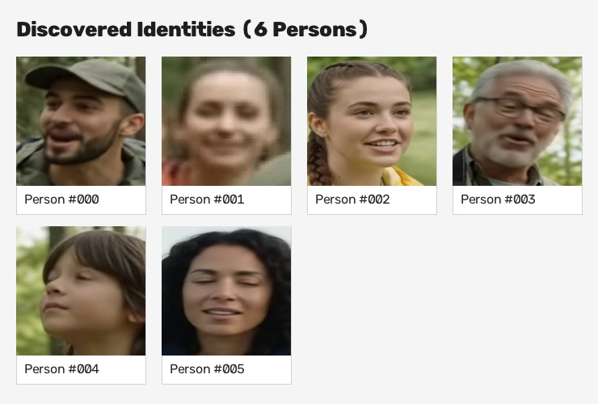
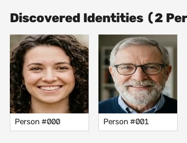

# Video Face Recognition & Clustering Pipeline

An intelligent, lightweight, and robust Python system that extracts human faces from any video, recognizes unique identities using deep neural network embeddings, and automatically clusters them into organized folders by person ID (`person_000/`, `person_001/`, etc.).

---

## 🤖 Viktig merknad om AI-generert innhold / AI Disclosure

> [!IMPORTANT]
> **Alle bilder og videoer i dette prosjektet er syntetiske og AI-generert med Google Gemini.**
> 
> * **Bilder:** Portrettbildene i `data/` (`person_a.jpg`, `person_b.jpg`).
> * **Videoer:** Både `sample_test_video.mp4` og `gemini_generated_video_d6f2b3bb.mp4`.
> 
> Ingen av ansiktene eller videoklippene forestiller ekte personer; alt demonstrasjonsmateriale er generert ved hjelp av Gemini.

---

## 📊 Resultater / Clustering Results

Når pipelinen kjøres, opprettes mapper for hver identifiserte person, metadata i JSON-format, og en automatisk visuell identitetsmontasje (`identities_montage.jpg`).

### Kjøring 1: 6 unike personer (`gemini_generated_video_d6f2b3bb.mp4`)

Kjørt med:
```powershell
python main.py --video gemini_generated_video_d6f2b3bb.mp4 --output face_clusters_output --frame-interval 5
```

**Visuell montasje av identifiserte personer:**



**Sammendrag fra analysen:**
- **Antall frames skannet:** 172 frames
- **Detekterte ansikter totalt:** 33 ansikter
- **Oppdagede unike personer:** 6 distinkte identitetsklynger (`person_000` til `person_005`)
- **Støy/Uskarpe ansikter sortert ut:** 1 ansikt (`unclustered/`)
- **Silhouette Score:** `0.6415` (bekrefter solid matematisk separasjon mellom personene)

**Mappestruktur for resultatene:**
```text
face_clusters_output/
├── identities_montage.jpg   # Samlet bildekort av personene
├── metadata.json            # Detaljert tidsstempel, bounding box og konfidensscore
├── person_000/              # 6 ansiktsbilder
├── person_001/              # 3 ansiktsbilder
├── person_002/              # 5 ansiktsbilder
├── person_003/              # 7 ansiktsbilder
├── person_004/              # 6 ansiktsbilder
├── person_005/              # 5 ansiktsbilder
└── unclustered/             # 1 støy-/uskarpt bilde
```

---

### Kjøring 2: 2 personer med samtidig overlapping (`sample_test_video.mp4`)

Kjørt med:
```powershell
python main.py --video sample_test_video.mp4 --output test_output --frame-interval 5
```

**Visuell montasje:**



**Sammendrag:**
- **Detekterte ansikter:** 24 ansikter
- **Oppdagede personer:** 2 identiteter (`person_000`: 11 bilder, `person_001`: 13 bilder)
- **Silhouette Score:** `0.8954` (eksepsjonelt høy klyngeskarphet)
- **Overlappingshåndtering:** I tidsrommet mellom `1.40s` og `2.00s` var begge personene i bildet samtidig. Systemet gjenkjente begge ansiktene uavhengig og plasserte dem 100% presist i hver sin mappe.

---

## 🚀 Hovedfunksjoner / Features

- **Dyp læring uten C++ build-verktøy**: Bruker OpenCVs innebygde **YuNet** (ansiktsdeteksjon med 5 landemerker) og **SFace** (128-dimensjonal dyp feature extraction). Ingen behov for Visual Studio C++, CMake, dlib, PyTorch eller CUDA.
- **Smart klynging (Clustering)**:
  - **DBSCAN (Standard)**: Finner automatisk antall distinkte personer basert på tetthet i cosinus-rommet, og plasserer uskarpe/støyete feil-deteksjoner i `unclustered/`.
  - **Agglomerative (Hierarkisk)**: Alternativ avstandsbasert klynging med koblings-terskel.
- **Naturlige portrett-utsnitt**: Legger til en justerbar marg (standard 25%) rundt ansiktsrammen slik at bildene blir fine portretter i stedet for kuttet ved kjeven.
- **Automatisk modellnedlasting**: Modellfilene (`.onnx`) lastes automatisk ned fra offisielle OpenCV Zoo ved første gangs kjøring.

---

## 🛠️ Installasjon / Setup

1. **Klon repoet:**
   ```bash
   git clone https://github.com/roblar658/faceImagesExtractAndClusterFromVideo.git
   cd faceImagesExtractAndClusterFromVideo
   ```

2. **Opprett virtuelt miljø og installer avhengigheter:**
   ```bash
   python -m venv .venv
   
   # På Windows:
   .\.venv\Scripts\activate
   pip install -r requirements.txt

   # På Linux/macOS:
   source .venv/bin/activate
   pip install -r requirements.txt
   ```

---

## 💻 Bruk / Usage

### 1. Kjør på din egen video:
```bash
python main.py --video "sti/til/din_video.mp4" --output "resultater" --frame-interval 5
```

### 2. Test med en av de inkluderte demovideoene:
```bash
# 6 personer test:
python main.py --video gemini_generated_video_d6f2b3bb.mp4 --output face_clusters_output --frame-interval 5

# 2 personer med overlapping test:
python main.py --video sample_test_video.mp4 --output test_output --frame-interval 5
```

---

## ⚙️ Kommandolinjevalg / CLI Arguments

| Parameter | Type | Standard | Beskrivelse |
| :--- | :--- | :--- | :--- |
| `--video` | string | *påkrevd* | Sti til videofilen (`.mp4`, `.avi`, `.mov`, `.mkv`). |
| `--output` | string | `face_clusters_output` | Mappe der ansiktsbildene, montasjen og metadata lagres. |
| `--frame-interval` | int | `5` | Skanner hver N-te frame (f.eks. 5 = ~5-6 frames/sek ved 25-30 fps). |
| `--method` | choice | `dbscan` | Klyngealgoritme (`dbscan` eller `agglomerative`). |
| `--eps` | float | `0.45` | Cosinus-avstandsterskel (lavere = strengere, høyere = slår sammen mer). |
| `--min-samples` | int | `2` | Minimum antall observasjoner for å danne en gyldig personklynge i DBSCAN. |
| `--score-thresh` | float | `0.8` | Minimum deteksjonskonfidens fra YuNet (0.0 til 1.0). |
| `--crop-margin` | float | `0.25` | Ekstra marg (prosent) rundt ansiktsutsnitt for naturlig portrett (0.25 = 25%). |
| `--use-aligned` | flag | `False` | Lagre 112x112 roterte/justerte ansiktsutdrag i stedet for naturlige portretter. |

---

## 📂 Prosjektstruktur

```text
├── main.py                             # CLI-inngangspunkt
├── clusterer.py                        # Kjernealgoritme: deteksjon, SFace-vektorer og klynging
├── generate_sample_video.py            # Skript for å generere syntetisk testvideo
├── requirements.txt                    # Nødvendige Python-pakker (OpenCV, scikit-learn, etc.)
├── README.md                           # Dokumentasjon, resultatoversikt og Gemini AI disclosure
├── data/                               # AI-genererte referanseportretter (Gemini)
│   ├── person_a.jpg
│   └── person_b.jpg
├── sample_test_video.mp4               # AI-generert testvideo med 2 overlappende personer (Gemini)
├── gemini_generated_video_d6f2b3bb.mp4 # AI-generert testvideo med 6 personer (Gemini)
├── face_clusters_output/               # Resultater fra 6-personers kjøring
│   ├── identities_montage.jpg
│   ├── metadata.json
│   ├── person_000/ ... person_005/
│   └── unclustered/
└── test_output/                        # Resultater fra 2-personers kjøring
    ├── identities_montage.jpg
    ├── metadata.json
    ├── person_000/
    └── person_001/
```
